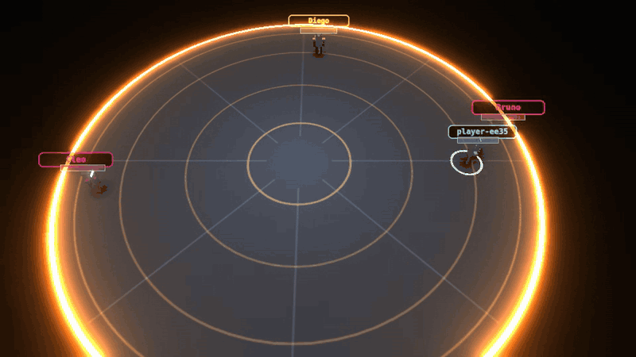
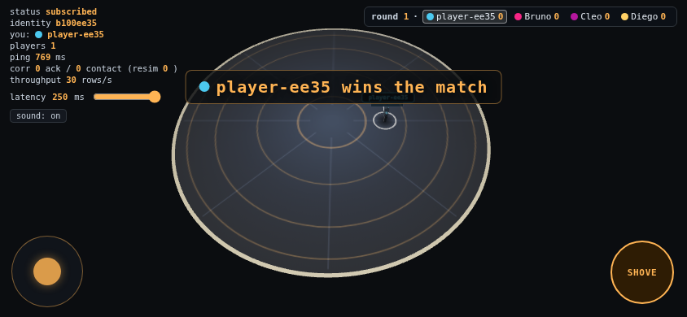

# RINGOUT

Server-authoritative physics arena for 2–4 players. Three.js client, SpacetimeDB module as the only server.

> Status: playable, deployed, and measured. Every number below was produced by
> a command or URL named next to it; nothing here is an estimate.

**[Play it](https://independent-scientist.github.io/ringout/)** — no install, and two browser tabs are two
players. Alone, seat up to three CPU opponents from the lobby (`+ CPU`) and play a full match.
**Netcode write-up:** [`docs/netcode.md`](docs/netcode.md). **Demo:** [70-second clip
(mp4)](docs/media/demo.mp4) of a round on the deployed build.



On a phone it locks to landscape and gives you a stick and a shove button:



*That capture has the 250 ms latency shim switched on, which is why the HUD reads 769 ms end to end; the shim is
wired into both directions and the same slider is how the correction counters get measured.*

## What it is

Up to four robots stand on a disc that shrinks. No weapons, no health bars. You shove; the floor decides who
stays. Best of three rounds, ninety seconds per round.

## What is actually hard here

- **Server authority at 30 Hz.** Every position, impulse and elimination is computed in a SpacetimeDB module
  (`module/src/sim/step.ts`), driven by a schedule table. The client never decides.
- **Prediction and rollback measured under packet loss.** Your own body moves the instant you press a key; when
  the server's state arrives, unacknowledged inputs are replayed from the server's version and the visual error
  is smoothed away. The HUD splits reconciliations into `ack` corrections (a server row disagrees with the
  replayed single-body prediction — the netcode error) and `contact` corrections (the server applied a body-body
  collision or shove impulse the client deliberately does not predict — the design trade-off).
  At 250 ms one-way, four scripted clients (`?brawl=1&autopilot=250&seconds=25`) produced `2 ack / 5 contact`
  corrections in 25 s with `0` snaps and `112` resim steps. Contact corrections are the physics working, not the
  netcode failing: the client deliberately does not predict a body-body collision. Inputs are sent with the
  previous unacked frame attached, so a single lost packet costs nothing; the chaos harness
  (`?autopilot=250&chaos=10&pin=1`) drops inputs and stalls the send path and prints `RINGOUT_METRICS` when its
  window closes.
- **Momentum the stick cannot cancel.** Velocity is split into two channels: `v`, which the stick asks for and a
  servo drives, and `k`, which the world writes — shove lunges and collision impulses. Friction is the only thing
  that removes `k`, and while it is live the stick steers at 35 % authority. A shove therefore lands on a player
  who is actively walking into it: measured on the shared integrator, a victim pushing back keeps 69 % of the
  knockback 250 ms after contact and travels 2.82 m in the first second, where the old single-channel model left
  them 0.60 m *behind* where they started.
- **CPU opponents on the player's own input path.** A bot is a server-side seat with a synthetic identity. Its
  brain emits `Command`s — the same `steer` / `aim` / `charge` vocabulary a keyboard produces — which run through
  the same executor into the same input frame and the same `stepBody`. It cannot move in a way a player could
  not, and adding it needed no branch in the physics. It is also not superhuman: the client reports the round
  trip it measures, and a CPU looks at the world only once per that interval, so on a 170 ms link it is as slow
  to notice your dodge as you are to see its shove.
- **A floor worth fighting over.** Every nine seconds a boost drops on a ring inside the arena: an amber fist
  (`POWER`, heavier shove), a red bolt (`HASTE`, faster feet) or a blue crystal cluster (`HEAVY`, slower and
  weaker — the trap). Each is visible from across the disc and arms 1.2 s after it lands, so taking one is a
  race, not a lottery, and the CPU breaks off the fight to contest it. Measured on the shared integrator
  (`tools/boost.test.ts`): POWER puts 1.34x the impulse into the body it hits, HASTE covers 8.19 m in the first
  second against 6.07 m, HEAVY drops that to about 3.6 m.
- **A latency simulator you can toggle.** 0 / 100 / 250 ms one-way, wired through both directions, with the
  resulting correction rate on screen. The hard part is observable on purpose.
- **One integrator, two runners.** The browser imports the module's simulation file through a Vite alias, so
  prediction cannot drift from authority by construction.

## Architecture



The module owns the world: `player`, `match`, `match_score`, `body`, `input_frame`, `event`, `bot` and the
`match_tick` schedule, written by the reducers (`join_lobby`, `create_match`, `join_match`, `set_ready`,
`add_bot`, `remove_bot`, `start_match`, `submit_inputs`) and by the 30 Hz tick. Body rows stream to the browser over the WebSocket; the
client interpolates other players, predicts its own body, and renders. Both runners import
`module/src/sim/step.ts`, so prediction and authority cannot diverge by construction. The diagram's source is
[`docs/diagrams/architecture.html`](docs/diagrams/architecture.html).

## Measured metrics

Each row names how it was produced; the longer version, including what was rejected and why, is
[`docs/netcode.md`](docs/netcode.md).

| Metric | Value |
| --- | --- |
| Server tick | 33.33 ms mean, σ 1.15–2.51 ms (4 bots, 45 s) |
| Determinism | 1000 ticks, byte-identical state |
| Corrections at 250 ms, 4-player brawl | 2 ack / 5 contact in 25 s, 0 snaps (`?brawl=1&autopilot=250&seconds=25`) |
| Shove against a victim walking into it | 69 % of knockback kept at 250 ms, 2.82 m slide (`node tools/momentum.test.ts`) |
| CPU match, 3 bots + 1 human | 408 shove releases, 478 contacts, eliminations, both round outcomes (`node tools/cpu-match.ts`) |
| Throughput, 3–4 players | 100–180 rows/s per client |
| Client bundle | 190.08 kB gzip |
| Frame time, laptop iGPU | 1.22 ms mean, 59.6 fps, 24 draw calls |
| RTT, Brazil → maincloud | 157–176 ms steady state |

## Design decisions, and what I rejected

- **Hand-rolled 2D capsule physics instead of Rapier/cannon.** The game is a top-down disc; a full 3D engine
  buys nothing and costs determinism, bundle size and server-copy complexity. The sim is ~120 lines.
- **Float32 simulation + reconciliation instead of fixed-point determinism.** Drift is absorbed by rollback;
  fixed-point would have cost a month for a benefit this game does not need. Documented in `docs/netcode.md`.
- **No client-side hit prediction.** Shove results come from the server only. Intent (wind-up, aim) is local.
  This trades ~RTT of feedback on impacts for the elimination of the worst mispredict class.
- **Row deltas, not snapshots.** Each body row carries `server_tick` and `last_seq`, so reconciliation needs no
  side channel and no per-tick snapshot table.

## Run it locally

```bash
spacetime start
spacetime publish ringout-dev --server local --delete-data=always --yes
spacetime generate --lang typescript --out-dir client/src/module_bindings --module-path module
npm install && npm run dev --workspace client      # http://localhost:5173
```

To test two players on one machine, open a second tab at `http://localhost:5173/?slot=2` — plain tabs share
localStorage and would be the same identity.

Requirements: Node 20+, the `spacetime` CLI, a WebGL2 browser. Controls: WASD to move, arrow keys to aim (with no
aim held you shove the way you were last moving), hold space to charge a shove, release to fire. Touch: left stick
to move and aim, right button to shove.

## Repo layout

`module/` server · `client/` browser · `shared/` constants · `tools/` harnesses · `docs/` architecture and
netcode.

## License

MIT (code). Asset credits in `docs/media/CREDITS.md`.
